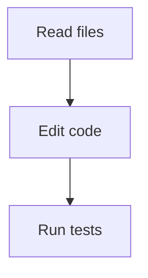

# README captures

These are captures of Hibiscus v0.3.13 running in real PTYs. The executable is
from the verified macOS ARM64 release, source commit
`deddeee2518d45baa6a70d423c7ab8f58d77eb4e`. Native runtime/UI code is unchanged in
the subsequent repository-security changes.

| Image | What it shows |
| --- | --- |
| `tui-tools.jpg` | Persistent HIBI header, native reads, a real file edit/diff and passing tests |
| `cli-tools.jpg` | A failing test, native edit/diff, then a successful rerun in the inline CLI |
| `tui-mermaid.jpg` | Native Markdown table layout and a completed linear Mermaid flowchart |

A loopback sample provider supplies the assistant prose and tool-call plans.
Hibiscus itself executes the reads, edits and Python tests against isolated demo
files. The initial CLI test fails because whitespace-only names have no fallback;
after the native edit, both tests pass. Its compact unittest reporter prints
actual results without absolute traceback paths. No real provider account,
personal workspace, credential or billable model call is used.

The terminal viewer displays the executable's unchanged ANSI output using
xterm.js 5.5.0, with Menlo 14 px. Captures include the actual terminal region,
without added UI, labels or reconstructed transcript text. TUI uses 116 columns
and 41 rows, CLI 116 × 40, and Mermaid 116 × 48. JPEG files come directly from
the browser screenshot API. Tool durations describe only these local examples.

The Mermaid example uses the supported linear `flowchart TD` form:

Its Unicode diagram appears after the native response settles. These images
demonstrate the application presentation with sample content, not a particular
model's coding ability or a performance benchmark. Re-capture from the running
application when UI behavior changes; keep original session data and private
credentials out of public assets.
